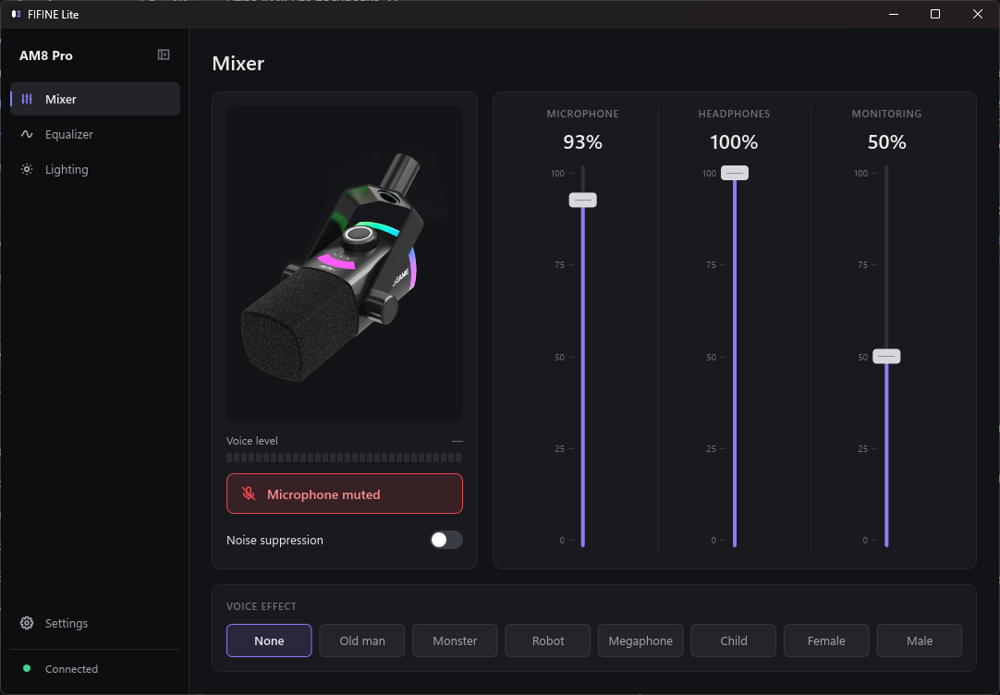
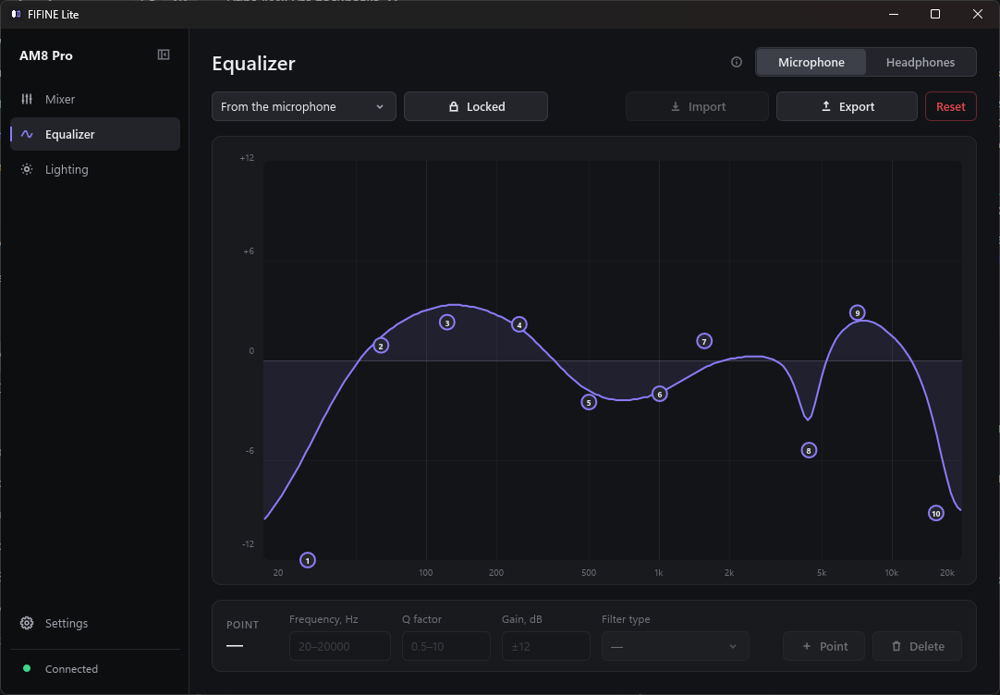
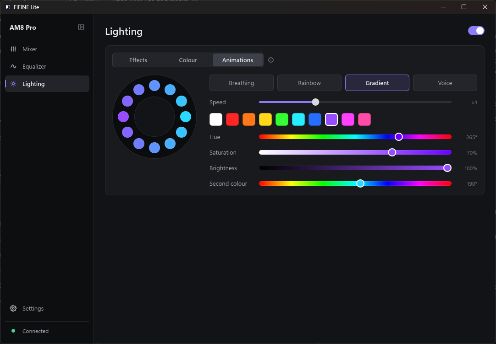

# FIFINE Lite

**English** · [Русский](README.ru.md)

A small, fast Windows app for controlling fifine USB microphones. It replaces the
microphone screens of fifine Genie with a single ~17 MB executable that sits in the tray
and uses no CPU while it is there.

It talks to the microphone directly over USB HID. fifine Genie does not have to be
installed or running.

> Unofficial project, not affiliated with or endorsed by fifine.



| Equalizer | Lighting |
|---|---|
|  |  |

## Features

- **Mixer** – microphone gain, headphone volume and monitor mix, mute, noise suppression,
  a live voice level meter, voice effects.
- **Equalizer** – 10 points for the microphone and for the headphone output, the presets
  from Genie, drag points on the curve or type exact values, import and export in Genie's
  format.
- **Lighting** – the built-in effects (with your own labels for them), a custom colour for
  the whole ring or for each LED, and animations: breathing, rainbow, gradient and a
  voice-reactive level ring.
- **Several microphones** – every supported microphone that is plugged in appears in a
  picker; each model keeps its own lighting settings.
- **Tray** – closes to the tray, the icon turns red while the microphone is muted, the menu
  mutes without opening the window. Optional start with Windows.
- **English and Russian** – follows the Windows language (Russian on a Russian system,
  English everywhere else) and can be switched in the settings.

The window shows only what the connected model can do: a microphone without volume faders
or voice effects simply has no such controls.

## Supported microphones

| Model | Status | Controls |
|---|---|---|
| AM8 Pro | Tested on hardware | Everything above |
| AM9 | Untested | Mute, noise suppression, voice effects, EQ, lighting |
| A9 | Untested | Mute, noise suppression, voice effects, pickup pattern, EQ, lighting |
| A8 Plus | Untested | Lighting (custom colours and animations) |
| AM8 | Untested | Mute, noise suppression (3 levels), low cut, mid boost, monitor mix, EQ, lighting |
| AM68 | Untested | Mute, noise suppression (3 levels), gain, headphone volume, monitor mix, EQ, lighting |

"Untested" models are built from the device tables inside fifine Genie and have not been
run against the real microphone. They are marked with a **β** next to the model name.
Reports from owners are very welcome: open an issue and attach the output of
`cargo run --release --example probe`.

fifine headsets and SC sound cards are not supported.

## Install

There are no prebuilt downloads yet; build it from source.

1. Install [Rust](https://rustup.rs) (stable, MSVC toolchain).
2. Build:

   ```
   cargo build --release
   ```

3. Run `target\release\fifine-lite.exe`. Copy it anywhere you like; it is a single file.

Windows 10 and 11 are supported. Settings are stored in
`%APPDATA%\fifine-lite\settings.json`.

## Good to know

- On the **AM8 Pro** a custom colour is stored by the microphone itself and stays after
  the app quits. Animations need the app running (the tray is enough).
- On the other models custom colours and animations are streamed from the computer, so the
  app has to keep running for them.
- The voice level meter opens the microphone only while the mixer page is on screen, so
  Windows shows "microphone in use" only then. The voice-reactive lighting keeps it open
  for as long as it is selected.
- The app never sends anything over the network.

## How it works

fifine microphones share one HID protocol (`A5 5A FE …` packets): short commands for
settings, a 256-byte packet for the equalizer, one colour frame per ring update, and a
state report that the app polls a little more than once a second.

What differs between models is described in one place, [`src/profile.rs`](src/profile.rs):
the USB product ID, the number of LEDs, the command code of each setting and where that
setting sits in the state report. The window is laid out from the same description.

| File | Role |
|---|---|
| `src/profile.rs` | Per-model tables |
| `src/protocol.rs` | Packet building and state report parsing |
| `src/device.rs` | The HID thread: discovery, commands, lighting stream, polling |
| `src/light.rs` | Colour frames and animations |
| `src/eq.rs`, `src/editor.rs` | Equalizer presets, curve and editing rules |
| `src/main.rs`, `ui/app.slint` | The app and its [Slint](https://slint.dev) interface |
| `lang/` | Russian translation |

### Adding a model

Add an entry to `PROFILES` in `src/profile.rs` with the model's product ID, LED count,
command codes and report offsets, and set `verified: false` until someone has run it on
the device. No interface code has to change.

## License

Copyright © 2026 Holorigg. Licensed under the
[GNU General Public License v3.0](LICENSE) (GPL-3.0-only).

You may use, study, change and share the app, including for money. Anything you
distribute that is built on this code must also be released under GPL v3 with its full
source code.

The microphone picture and the equalizer presets come from fifine Genie and belong to
fifine; they are not covered by the GPL. "fifine" is a trademark of its owner.
