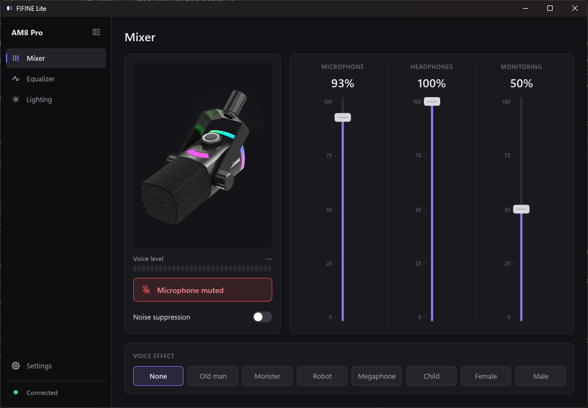
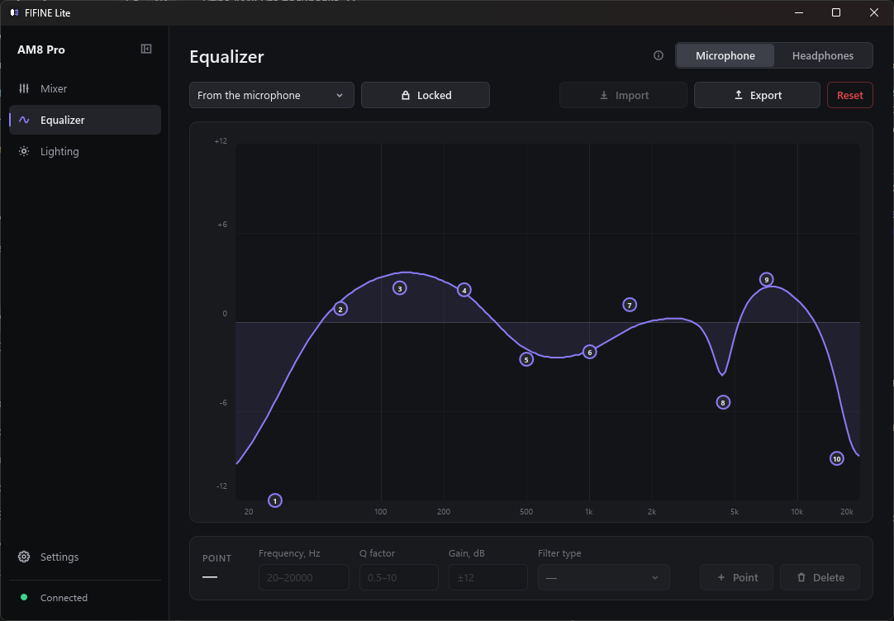
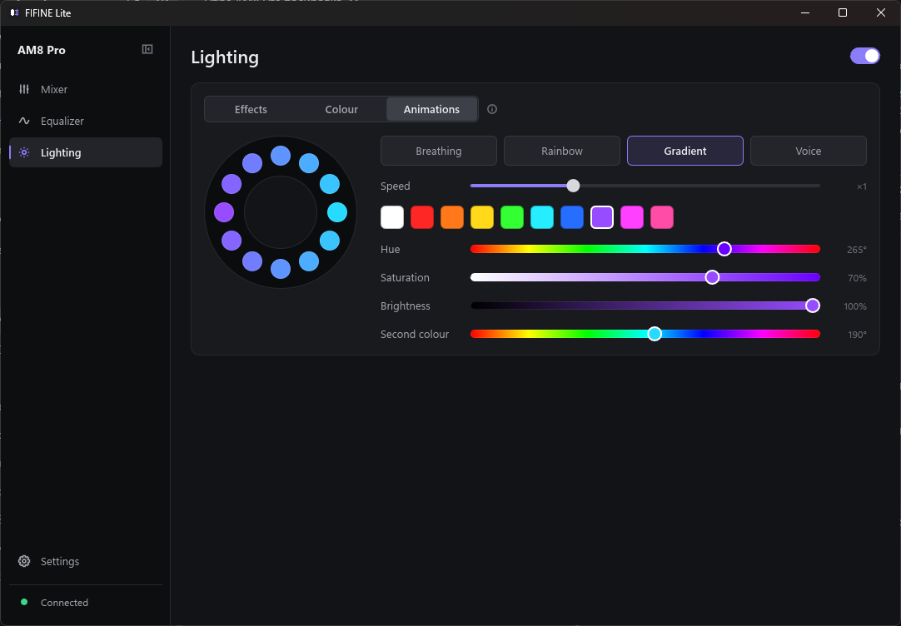

# FIFINE Lite

[English](README.md) · **Русский**

Небольшая быстрая программа для Windows, которая управляет USB-микрофонами fifine. Она
заменяет экраны микрофона из fifine Genie одним исполняемым файлом на ~17 МБ, который
живёт в трее и не нагружает процессор, пока свёрнут.

Программа общается с микрофоном напрямую по USB HID. Ставить или запускать fifine Genie
не нужно.

> Неофициальный проект, не связан с fifine и не одобрен ею.

| Эквалайзер | Подсветка |
|---|---|
|  |  |

На скриншотах английский интерфейс; на русской Windows программа сразу запускается на русском.

## Возможности

- **Микшер** — усиление микрофона, громкость наушников и баланс мониторинга, выключение
  микрофона, шумоподавление, индикатор уровня голоса, эффекты голоса.
- **Эквалайзер** — 10 точек для микрофона и для выхода на наушники, пресеты из Genie,
  точки можно таскать по кривой или вводить точные значения, импорт и экспорт в формате
  Genie.
- **Подсветка** — встроенные эффекты (им можно дать свои названия), свой цвет на всё
  кольцо или на каждый светодиод и анимации: дыхание, радуга, градиент и кольцо-индикатор
  громкости голоса.
- **Несколько микрофонов** — все подключённые поддерживаемые микрофоны попадают в список
  выбора; настройки подсветки у каждой модели свои.
- **Трей** — окно закрывается в трей, значок краснеет, когда микрофон выключен, из меню
  можно выключить микрофон, не открывая окно. Есть автозапуск с Windows.
- **Русский и английский** — язык берётся из Windows (русский на русской системе,
  английский на любой другой) и переключается в настройках.

В окне есть только то, что умеет подключённая модель: если у микрофона нет регуляторов
громкости или эффектов голоса, этих элементов просто не будет.

## Поддерживаемые микрофоны

| Модель | Статус | Что управляется |
|---|---|---|
| AM8 Pro | Проверен на устройстве | Всё перечисленное выше |
| AM9 | Не проверен | Выключение, шумоподавление, эффекты голоса, эквалайзер, подсветка |
| A9 | Не проверен | Выключение, шумоподавление, эффекты голоса, направленность, эквалайзер, подсветка |
| A8 Plus | Не проверен | Подсветка (свой цвет и анимации) |
| AM8 | Не проверен | Выключение, шумоподавление (3 уровня), срез низких, подъём середины, мониторинг, эквалайзер, подсветка |
| AM68 | Не проверен | Выключение, шумоподавление (3 уровня), усиление, громкость наушников, мониторинг, эквалайзер, подсветка |

Модели со статусом «не проверен» собраны по таблицам устройств из fifine Genie и на
настоящем микрофоне не запускались. В программе они помечены значком **β** рядом с
названием модели. Отзывы владельцев очень нужны: заведите issue и приложите вывод
команды `cargo run --release --example probe`.

Гарнитуры fifine и звуковые карты серии SC не поддерживаются.

## Установка

Скачайте последнюю версию в разделе **[Releases](https://github.com/Holorigg/fifine-lite/releases/latest)**:

- **`FIFINE-Lite-x.y.z-setup-x64.exe`** — установщик. Ставит программу для текущего
  пользователя (права администратора не нужны), добавляет ярлык в меню «Пуск» и
  деинсталлятор, может сразу включить автозапуск.
- **`FIFINE-Lite-x.y.z-portable-x64.zip`** — портативная версия. Распакуйте куда угодно и
  запустите `fifine-lite.exe`.

Поддерживаются Windows 10 и 11 (64 бит). Обе версии хранят настройки в
`%APPDATA%\fifine-lite\settings.json`.

Файлы не подписаны цифровой подписью, поэтому при первом запуске Windows SmartScreen
может предупредить о неизвестном издателе: нажмите **Подробнее → Выполнить в любом
случае**. Контрольные суммы файлов — в `SHA256SUMS.txt` в том же релизе.

### Сборка из исходников

1. Установите [Rust](https://rustup.rs) (stable, набор инструментов MSVC).
2. Выполните `cargo build --release`; программа появится в `target\release\fifine-lite.exe`.
3. Чтобы собрать ещё и установщик с портативным архивом, установите
   [Inno Setup 6](https://jrsoftware.org/isinfo.php) и запустите `scripts\release.ps1`.
   Файлы появятся в `dist\`.

## Полезно знать

- **AM8 Pro** сам хранит свой цвет: он остаётся и после выхода из программы. Для анимаций
  программа должна работать (достаточно трея).
- На остальных моделях свой цвет и анимации передаются с компьютера, поэтому программа
  должна оставаться запущенной.
- Индикатор уровня голоса открывает микрофон, только пока на экране страница микшера, —
  значок Windows «микрофон используется» появляется только в это время. Подсветка,
  реагирующая на голос, держит микрофон открытым всё время, пока выбрана.
- Программа ничего не отправляет в сеть.

## Как это устроено

У микрофонов fifine общий HID-протокол (пакеты `A5 5A FE …`): короткие команды для
настроек, пакет на 256 байт для эквалайзера, один кадр цветов на каждое обновление кольца
и отчёт о состоянии, который программа опрашивает чуть чаще раза в секунду.

Различия между моделями описаны в одном месте — [`src/profile.rs`](src/profile.rs):
идентификатор USB-устройства, число светодиодов, код команды для каждой настройки и
место этой настройки в отчёте о состоянии. По тому же описанию строится окно.

| Файл | Назначение |
|---|---|
| `src/profile.rs` | Таблицы по моделям |
| `src/protocol.rs` | Сборка пакетов и разбор отчёта о состоянии |
| `src/device.rs` | Поток HID: поиск устройств, команды, поток подсветки, опрос |
| `src/light.rs` | Кадры цветов и анимации |
| `src/eq.rs`, `src/editor.rs` | Пресеты, кривая и правила редактирования эквалайзера |
| `src/main.rs`, `ui/app.slint` | Приложение и интерфейс на [Slint](https://slint.dev) |
| `lang/` | Русский перевод |

### Как добавить модель

Добавьте запись в `PROFILES` в `src/profile.rs`: идентификатор устройства, число
светодиодов, коды команд и смещения в отчёте. Пока модель никто не запустил на
устройстве, оставьте `verified: false`. Код интерфейса менять не нужно.

## Лицензия

© 2026 Holorigg. Распространяется по лицензии
[GNU General Public License v3.0](LICENSE) (GPL-3.0-only).

Программой можно пользоваться, изучать и менять код, делиться ею — в том числе за деньги.
Всё, что распространяется на основе этого кода, тоже должно выходить под GPL v3 вместе
с полным исходным кодом.

Изображение микрофона и пресеты эквалайзера взяты из fifine Genie и принадлежат fifine;
на них GPL не распространяется. «fifine» — товарный знак его владельца.
